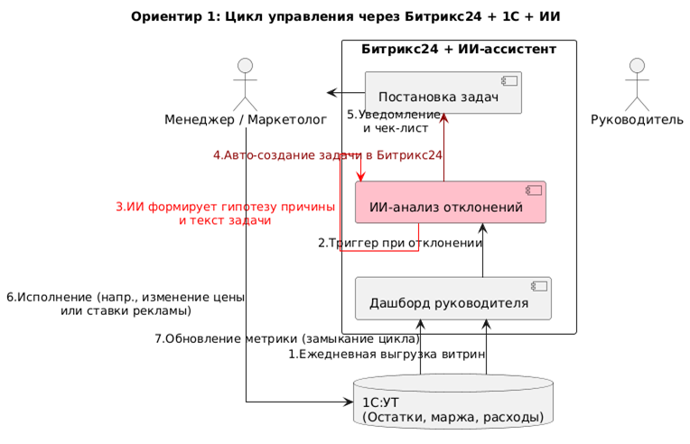
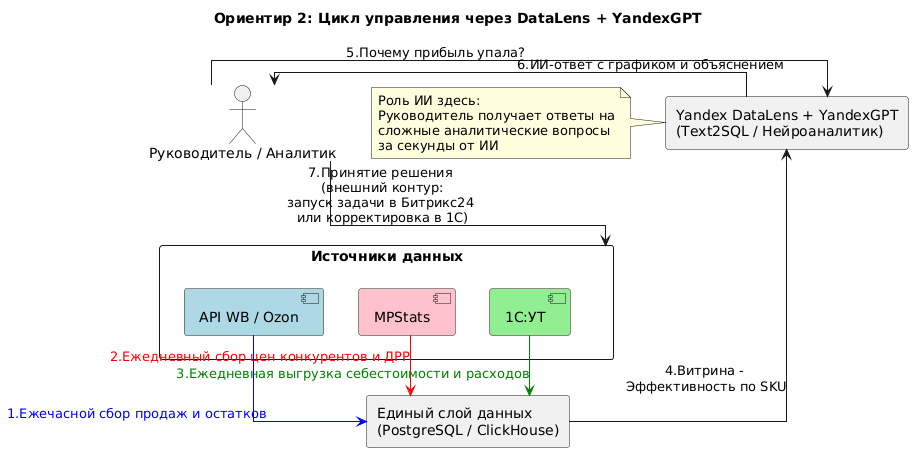

**Построение системы управления бизнесом с помощью ИИ для малого и среднего (МСБ) бизнеса продающего свои товары на маркетплейсах.**

**Ориентир №1: Связка «1С:УТ + Битрикс24 + ИИ-ассистент (КоПилот / GigaChat)»**

Этот вариант подходит, если вы хотите максимально использовать уже имеющиеся лицензии и внедрить ИИ точечно, в точки принятия операционных решений.

- Что система делает и роль ИИ: Битрикс24 выступает единым окном для коммуникаций и задач, а 1С — источником истины по финансам и остаткам. ИИ (нативный КоПилот Битрикс24 или интеграция с GigaChat) выступает в роли «умного помощника»: он анализирует оценки звонков по скриптам, суммирует длинные переписки по сделкам, генерирует черновики задач и, при наличии коннектора, может отвечать на вопросы по данным 1С
- Что стоит перенять для компании: Механику автоматического создания задач из алертов. Например: ИИ-детектор видит в выгрузке с Ozon, что ДРР (доля рекламных расходов) превысил норму, и автоматически создает в Битрикс24 задачу на маркетолога с уже сгенерированным ИИ кратким анализом причин и чек-листом действий.
- Ограничения: Нативный ИИ в Битрикс24 пока слаб в глубокой кросс-системной аналитике (например, «почему упала прибыль с учетом себестоимости из 1С и логистики с WB»). Для сложных финансовых ответов потребуется кастомная доработка (витрина данных), иначе модель может «галлюцинировать».
- На что опираюсь: Личный опыт проектирования подобных brownfield-интеграций для mid-market компаний, а также официальные возможности платформы.
- Рабочие ссылки и визуал:
  - Видео-обзор возможностей ИИ (КоПилот) в Битрикс24: [Обзор Битрикс24 Copilot: как ИИ помогает в CRM и задачах](https://www.iphones.ru/iNotes/bitrix-ai-review-04-15-2024"%20\t%20"_blank) <https://www.iphones.ru/iNotes/bitrix-ai-review-04-15-2024>
  - Пример ИИ-анализа данных в экосистеме: [Приложение «Анализ оценок звонков Ai CoPilot» в маркетплейсе Битрикс24](https://www.bitrix24.ru/apps/app/zenova_pro.analiz_zvonkov_ai_copilot_po_skriptam/) (демонстрирует, как ИИ сводит данные и дает рекомендации) <https://www.bitrix24.ru/apps/app/zenova_pro.analiz_zvonkov_ai_copilot_po_skriptam/>
  - Схема связи процессов управления:

**Ориентир №2: Аналитическая платформа Yandex DataLens + YandexGPT (Text2SQL)**

Этот вариант подходит, если вы готовы к небольшой кастомной разработке ради получения по-настоящему гибкого инструмента аналитики, который не зависит от ограничений коробочных CRM.

- Что система делает и роль ИИ: Скрипты (на Python/Airflow) забирают данные из API Wildberries, Ozon, MPStats и 1С, очищают их и складывают в единую базу (например, PostgreSQL или ClickHouse). Yandex DataLens строит дашборды. Ключевая роль ИИ (YandexGPT с функцией Text2SQL / Нейроаналитик) — позволить руководителю задавать вопросы к данным на естественном языке прямо в интерфейсе: _«Покажи топ-5 товаров по марже на WB за последнюю неделю, где остатки меньше 50 шт, и сравни с ценами конкурентов из MPStats»_.
- Что стоит перенять для компании: Концепцию единого семантического слоя. Вместо того чтобы смотреть 5 разных отчетов, вы строите одну витрину данных, где SKU из 1С, продажи с Ozon и расходы на рекламу из MPStats связаны по одному ключу. ИИ-чат поверх этой витрины дает мгновенные ответы без ожидания аналитика.
- Ограничения: Это не полностью коробочное решение «под ключ». Требуется дата-инженер (или внешний подрядчик) для настройки стабильного забора данных по API маркетплейсов (учитывая их лимиты) и поддержки качества данных (Data Quality).
- На что опираюсь: Официальные демонстрации Yandex Cloud и подтвержденные кейсы внедрения подобных стеков в e-commerce для замены разрозненных Excel-отчетов.
- Рабочие ссылки и визуал:
  - Официальное демо-видео Yandex DataLens (с обзором новинок, включая AI-функции и нейроаналитику): [Yandex DataLens: главные новинки и планы развития (VK Видео)](https://vk.com/video-200452713_456240375"%20\t%20"_blank) <https://vk.com/video-200452713_456240375>
  - Интерактивный демо-дашборд: [DataLens Demo Dashboard (раздел "AI и Нейроаналитик")](https://datalens.yandex/9fms9uae7ip02"%20\t%20"_blank) <https://datalens.yandex/9fms9uae7ip02> — можно посмотреть, как устроены чарты с поддержкой AI
  - Схема связи процессов управления:

**2\. Моё предложение для компании**

**Общий подход**

Я бы не строил новую платформу с нуля. У вас уже есть почти всё необходимое: 1С хранит себестоимость и расходы, Битрикс24 — задачи и коммуникации, подписки на сервисы аналитики дают конкурентов и позиции, маркетплейсы отдают данные через API. Не хватает трёх вещей: единого места, где эти данные сведены в одну картину по SKU и по каналам; слоя, который сам замечает отклонения и объясняет их человеческим языком; и замкнутой петли, когда решение из дашборда превращается в задачу, а результат задачи возвращается обратно в данные.

Поэтому предлагаю собирать систему из готовых блоков, дорабатывая только то, что купить нельзя.

**Что взять готовым, что связать, что доработать**

Готовым, без разработки:

- Битрикс24 — остаётся контуром исполнения задач. Ничего не меняем, используем как есть.
- 1С — источник истины по себестоимости, закупкам и расходам. Забираем данные регулярными выгрузками.
- DataLens (или Superset) — слой визуализации. Бесплатный или дешёвый, настраивается за дни, не требует поддержки.
- GigaChat или YandexGPT по API — для объяснений и текстов. Свои модели не обучаем и не размещаем, это не окупится на вашем масштабе.
- Сервисы аналитики (MPStats / Moneyplace / TrueStats) — используем то, что уже оплачено.

Связать (основной объём работ):

- Коннекторы к API Wildberries и Ozon: забор продаж, остатков, заказов, рекламных расходов с учётом лимитов и повторных попыток.
- Единая витрина данных. Это ключевой элемент: артикул из 1С должен связаться с артикулом на WB, с артикулом на Ozon и с позицией в сервисе аналитики. Без этой связки никакой ИИ не поможет — он будет уверенно считать неверные цифры.
- Юнит-экономика по SKU и по каналу: выручка минус комиссия, логистика, реклама, себестоимость, возвраты. Именно эта цифра сейчас, скорее всего, собирается вручную в Excel и именно её не хватает для решений.

Доработать (небольшая разработка):

- Детектор отклонений. Начинаем с простых правил и статистики, а не с машинного обучения: маржа ниже порога, ДРР выше порога, остаток меньше недельного запаса, позиция в выдаче упала, цена конкурента изменилась больше чем на N%.
- ИИ-слой поверх витрины: объяснение причины отклонения, утренняя сводка «что изменилось за сутки», формулировка задачи с чек-листом, ответы на вопросы руководителя на обычном языке.
- Обратная связь: статус и результат задачи из Битрикс24 возвращаются в витрину, чтобы система могла через неделю сама проверить, сработало ли решение.

Как этим будут пользоваться

Руководитель утром открывает одну страницу. Сверху — сводка за сутки, написанная текстом: что выросло, что упало, где аномалия. Ниже — алерты, каждый с причиной и предлагаемым действием. Рядом — строка вопроса: можно спросить «почему упала маржа по обезболивающим пластырям» и получить ответ с цифрами, а не идти к аналитику. По каждому алерту — две кнопки: согласовать предложенное действие или отклонить с комментарием.

Маркетолог, закупщик, менеджер получают задачу в Битрикс24. В задаче уже есть контекст: что случилось, какие цифры, что предлагается сделать, какой ожидается эффект, какой срок. Им не нужно ничего выяснять — нужно сделать и отметить результат.

Сотрудник, отвечающий за данные (или выделенный на полставки человек) раз в неделю смотрит журнал: какие алерты сработали, какие оказались ложными, какие задачи закрыты и какой эффект подтвердился. На основе этого пороги подкручиваются.

**Сценарий от проблемы до проверки результата**

Возьмём конкретный случай. SKU «Пластырь обезболивающий, 6 упаковок по 24 шт.», торгуется на Ozon.

Система обнаружила проблему. Утром во вторник детектор фиксирует: маржа по этому SKU за пять дней упала с 34% до 19%. Алерт уходит в дашборд. ИИ собирает причину из имеющихся данных и пишет её текстом: себестоимость в 1С не менялась, комиссия Ozon не менялась, а доля рекламных расходов выросла с 8% до 17%. По данным сервиса аналитики, конкурент из топ-5 снизил цену на 12% и увеличил рекламный бюджет — наши ставки в аукционе подтянулись вслед за ним. Позиция в выдаче при этом держится.

Система предложила решение. Два варианта с расчётом последствий. Вариант А: снизить ставки в кампании на 25%, принять падение позиции с 4-й на 7–8-ю, ожидаемый эффект — маржа 26–27%, объём продаж минус 10–15%. Вариант Б: ставку не трогать, вывести SKU из текущей акции и перейти на отгрузку со своего склада, чтобы сократить логистику, ожидаемый эффект — маржа 24%, объём сохраняется. Рекомендован вариант А, потому что он быстрее и обратим.

Человек согласовал. Руководитель смотрит оба варианта, нажимает «Согласовать А», при необходимости правит срок. Система создаёт задачу в Битрикс24 на маркетолога: описание, цифры, конкретные действия (снизить ставку в кампании X на 25%, срок — 2 дня), ожидаемый эффект.

Задача выполнена. Маркетолог меняет ставки, прикладывает ссылку на кампанию, отмечает задачу закрытой. Система фиксирует дату и значения метрик на момент закрытия.

Результат проверен. Через 7 дней система сама сравнивает факт с прогнозом: маржа вернулась к 26,4% (прогноз 26–27%), продажи снизились на 11% (прогноз 10–15%). Расчёт подтвердился — запись уходит в журнал решений и учитывается при следующих рекомендациях. Если бы факт разошёлся с прогнозом сильнее чем на 20%, руководитель получил бы отдельный алерт: решение не дало ожидаемого эффекта, причина требует разбора.

Так петля замыкается: каждое решение оставляет след, и со временем система начинает рекомендовать точнее, потому что опирается на историю ваших же решений, а не на общие шаблоны.

**Первый пилот**

Предлагаю не разворачивать всё сразу, а проверить идею на узком участке за 4–6 недель.

Что берём в пилот: один маркетплейс (Ozon или WB — какой для вас сейчас важнее), одна товарная группа (например, обезболивающие пластыри, примерно 30–50 SKU), один класс проблем — маржа и доля рекламных расходов.

Что делаем: коннектор к API выбранного маркетплейса, выгрузка себестоимости из 1С, связка артикулов, витрина юнит-экономики по SKU, пять-шесть правил детектирования, дашборд в DataLens, объяснение отклонений через LLM и автоматическая постановка задачи в Битрикс24.

Чего в пилоте не делаем: второй маркетплейс, собственные ML-модели, отдельный портал или мобильное приложение, речевую аналитику звонков, глубокий анализ конкурентов. Всё это добавляется позже, если пилот покажет пользу.

**По каким результатам оцениваем:**

1. Витрина собирается автоматически каждый день, расхождение с официальным отчётом маркетплейса по выручке меньше 2%.
2. Руководитель узнаёт о проблеме в день её возникновения, а не при ежемесячном сведении отчётов.
3. Не меньше 70% алертов в течение рабочего дня превращаются в задачу в Битрикс24 с назначенным исполнителем.
4. По закрытым задачам видно измеримое изменение метрики, и оно совпадает с прогнозом в пределах 20%.
5. Руководитель и маркетолог экономят 3–5 часов в неделю на ручной сборке отчётов — замеряем простым опросом до старта и после.

Пункты 1 и 2 проверяют, что данным можно верить. Пункты 3 и 4 — что система меняет поведение, а не просто показывает графики. Пункт 5 — что эффект ощущается людьми. Если через шесть недель хотя бы первые три пункта не выполнены, продолжать в текущем виде нет смысла — нужно чинить данные или менять сценарий.

**Главный риск**

Качество и сопоставимость данных. Если артикулы в 1С, на Wildberries и на Ozon не связаны между собой, а сопоставление сейчас ведётся вручную в чьей-то таблице, то юнит-экономика будет считаться неправильно. ИИ при этом не скажет «я не знаю» — он уверенно объяснит неверные цифры, и руководитель примет неверное решение. После двух-трёх таких случаев доверие к системе пропадает, и вернуть его практически невозможно.

Поэтому первая задача пилота — не искусственный интеллект, а справочник артикулов и сверка цифр с отчётами маркетплейсов. Только убедившись, что цифры сходятся, можно включать объяснения и рекомендации.

Второй по значимости риск — человеческий. Если алертов будет много и большинство окажется пустяковыми, их перестанут читать через две недели. Лечится жёсткими порогами на старте: лучше три точных сигнала в неделю, чем тридцать шумных. И обязательной обратной связью по каждой задаче — система должна знать, чем закончилось её предложение.

**Вопросы, без ответов на которые двигаться нельзя**

1. Как сейчас связаны артикулы между 1С, Wildberries и Ozon? Есть единый внутренний код или сопоставление ведётся вручную? В каком виде оно хранится?
2. Какая конфигурация 1С используется и можно ли получать данные через веб-сервисы или OData, либо только выгрузкой файлов? Кто со стороны вашей компании сможет это поддержать?
3. Какие сервисы аналитики уже оплачены и есть ли к ним API-доступ, или данные можно забирать только из интерфейса?
4. Как у вас сейчас считается маржа? Входят ли в неё комиссия маркетплейса, логистика, реклама, возвраты, эквайринг? Есть ли утверждённая формула, или каждый считает по-своему?
5. Формула юнит-экономики одинакова для WB и Ozon, или различается? Возвраты и брак как учитываются?
6. Какие серверные мощности уже есть, кто их администрирует и можно ли там разместить базу данных и скрипты сбора? Или предпочтительнее облако?
7. Если уже есть отдельные ИИ-решения. Что именно работает, кто это делал, где размещено и есть ли документация с доступами? Это важно — чтобы предпочёл встроить их в общую картину, а не переделывать.
8. Кто внутри компании будет владельцем системы: кто принимает решения по алертам, кто отвечает за качество данных, кто контролирует исполнение задач? Без конкретного человека на этой роли система быстро превратится в заброшенный дашборд.
9. Какие три решения руководитель принимает чаще всего и дольше всего ждёт для них данных? Пилот должен бить в одну из этих точек, а не в аналитику вообще.